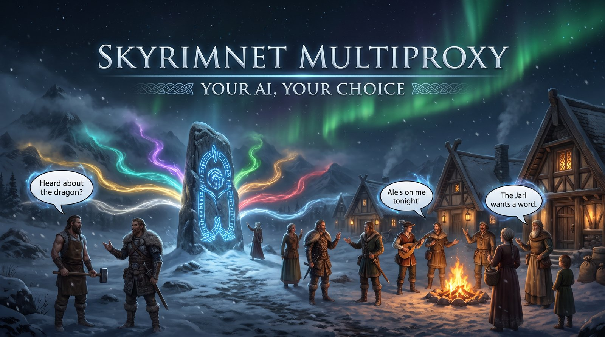

 

# SkyrimNet MultiProxy

> **Connect your AI of choice to SkyrimNet — set it up once, and Skyrim starts it for you every time you play.**

---

## ⚡ Overview

[SkyrimNet](https://github.com/MinLL/SkyrimNet-GamePlugin) uses AI for a lot more than NPC dialogue: conversations, NPC actions, diaries, bios, the GameMaster, and more. All of that needs an OpenAI-compatible endpoint to talk to. SkyrimNet MultiProxy is that bridge: a lightweight background tool running on your PC that receives SkyrimNet's AI requests and routes each one to the AI model you choose.

Pick whichever AI fits your setup:

- **Subscriptions (no API keys):** Use your existing Claude, ChatGPT, or Google AI Pro account.
- **API keys:** OpenRouter, GLM (z.ai), Nano-GPT, OpenAI, DeepSeek, or Kilo Gateway.
- **Ollama:** Run free models locally on your PC, or connect to Ollama Cloud with an API key.

Everything is included in one package: an SKSE plugin that manages the proxy lifecycle alongside the game, and a complete, ready-to-run copy of the proxy.

### 📋 At a Glance
| Feature | Details |
| :--- | :--- |
| **Requirements** | [SKSE64](https://skse.silverlock.org/), Python 3.10+ (`setup.bat` can install it for you), and any supported AI option (Claude/ChatGPT login, an API key, or Ollama) |
| **Performance Impact** | The SKSE plugin runs once at startup, then goes idle. In-game reply speed depends on your chosen AI provider |
| **Safety** | Never touches save files. If the proxy is already running on its port, the plugin leaves it alone |
| **Compatibility** | Skyrim SE, SkyrimNet Beta 24 and Beta 25 |

---

## ✨ Key Features

* **Speeds tab:** See how your AIs are actually performing live on the dashboard. Dedicated health cards flag whether a service is running smooth, dragging its feet, or throwing errors. Each model tracks when it starts talking, total reply time, reply speed, and reliability—categorized by SkyrimNet job, with Dialogue ranked first to keep conversational pauses short. Your history survives restarts, complete with time filters and head-to-head job leaderboards.
* **Vision support:** SkyrimNet's screenshot analysis (OmniSight) works properly now, through any of the providers below.
* **Ready for SkyrimNet Beta 25:** When an AI stalls or fails, Beta 25 can smoothly fall back to your next provider in line, and MultiProxy now reports real errors so that switch actually fires instead of an NPC reading a glitch aloud. Dropped race requests get cleaned up quietly without dinging your stats on the Speeds tab. Voice cues pass straight through to suit whatever voice engine your NPCs use, though Higgs users can turn on `FixHiggsVoiceTags` to tidy them automatically.
* **Tougher under pressure:** Dropped connections retry on their own, chats that run too long get trimmed in the middle and retried instead of going silent, and garbled markup tags get cleaned up before SkyrimNet ever sees them. You can also set waiting lines under `[Concurrency]` in `proxy.ini` so busy providers don't trip their rate limits. The dashboard shows how busy each capped provider is, so you can see who's swamped at a glance.
* **Complete package:** Includes both the SKSE plugin and the full proxy script in a single download.
* **Starts automatically:** When Skyrim boots, the plugin checks if the proxy is already active. If not, it launches it silently in the background.
* **Ten AI providers:** Claude, ChatGPT, and Google Antigravity (via CLI logins), OpenRouter, GLM (z.ai), Nano-GPT, OpenAI, DeepSeek, Kilo Gateway, and Ollama. Mix and match — SkyrimNet lets you give different jobs different models, and each request is routed automatically based on its model name.
* **Codex, your way:** Stick with your ChatGPT subscription, or point Codex at OpenAI's official API, a local Ollama or LM Studio install, or any other OpenAI-compatible endpoint — right from the dashboard's Codex card. Know a model ID that works but isn't in the list? Pin it and it'll show up for good.
* **Your Google subscription counts:** Already paying for Google AI Pro or Ultra? Install [Google's Antigravity CLI](https://antigravity.google), sign in once, and use `antigravity-MODEL` — no API key required. That login isn't limited to Gemini either: the dashboard lists whichever models your account can actually run, Claude and GPT-OSS models included, with a **Refresh** button for when Google changes the lineup.
* **No Claude required:** Use whichever provider you prefer. Claude configuration is only needed if you choose a Claude model.
* **Local web dashboard:** Visit `http://127.0.0.1:8000` to save keys, check provider status, and copy model strings. Selecting a provider displays its key, model list, and readiness status.
* **Automatic Ollama model list:** The dashboard detects and lists your locally installed Ollama models, complete with a **Refresh** button for newly pulled models. Enter an Ollama Cloud key to view hosted models instead.
* **Built-in Quick Test:** Test any configured provider right from the dashboard — pick from six named scenarios (or write your own) and get a real, multi-turn chat window so you can keep the conversation going, with clear, plain-language error explanations if something goes wrong.
* **Optional auto-close:** Enable `AutoCloseWithSkyrim` in `proxy.ini` to shut down the proxy automatically when Skyrim closes.

---

## 📦 Getting Started

1. **Download and extract the release:** Extract the release zip anywhere on your system to create your `SkyrimNet MultiProxy` folder (e.g., `C:\Tools\SkyrimNet MultiProxy\`).
2. **Run the setup script:** Double-click **`setup.bat`** inside that folder. It checks for Python (and installs it via winget if it's missing), installs the required dependencies, and prints the exact path values you need for step 4.
3. **Install the SKSE plugin:** Import **`SkyrimNetMultiProxy.zip`** (it's inside your `SkyrimNet MultiProxy` folder) into your mod manager (Vortex or Mod Organizer 2) and enable it. This places `SkyrimNetMultiProxy.dll` and `SkyrimNetMultiProxy.ini` into your game's `Data/SKSE/Plugins/` directory.
4. **Configure `SkyrimNetMultiProxy.ini`:** Open the file (in `Data/SKSE/Plugins/` or via your mod manager) and fill in the values printed by `setup.bat`:
   - `PythonExe` — Full path to your `python.exe`
   - `ProxyScript` — Full path to `proxy.py` in your `SkyrimNet MultiProxy` folder
   - `WorkDir` — Full path to your `SkyrimNet MultiProxy` folder
   - `Port` — Port the proxy listens on (default: `8000`)
5. **Launch Skyrim:** Start Skyrim normally through SKSE. The proxy will launch in the background.
6. **Configure your AI provider:** Open `http://127.0.0.1:8000` in your browser, choose your provider, and enter your credentials:
   - **Claude:** Install the [Claude CLI](https://docs.anthropic.com/en/docs/claude-code) and complete the login.
   - **ChatGPT:** Install the [Codex CLI](https://www.npmjs.com/package/@openai/codex) and run `codex login` once in a terminal (note: responses are generally slower per reply).
   - **Google Antigravity:** Install the [Antigravity CLI](https://antigravity.google) — on Windows, run `irm https://antigravity.google/cli/install.ps1 | iex` in PowerShell — then run `agy` once and sign in with the Google account your AI Pro or Ultra subscription is on (note: responses are generally slower per reply, same as ChatGPT above).
   - **API Key providers:** Paste your key into the dashboard.
   - **Ollama:** Ensure the Ollama service is running on your machine.
7. **Configure SkyrimNet:** In SkyrimNet's in-game or configuration settings:
   - Endpoint: `http://localhost:8000/v1/chat/completions`
   - API Key: Leave blank
   - Model: Copy your preferred model name directly from the dashboard using its **Copy** button.

> [!TIP]
> `PythonExe` already defaults to `py`, which correctly finds a real Python install from [python.org](https://www.python.org/downloads/). If you installed Python through the Microsoft Store's own app instead, use `python` there — that's real Python too, it just doesn't include `py`. Either way, avoid setting this to bare `python` on a system that's never had Python installed at all — Windows registers its own placeholder `python` command that silently opens the Microsoft Store instead of running anything.

> [!NOTE]
> The current release's proxy runtime is configured through `config.json` (via the dashboard or
> `config.example.json`) — there is no `proxy.ini.example` in this release, because the runtime
> does not read `proxy.ini`. The shipped runtime is proxy-only (no MCP server mode): it serves the
> OpenAI-compatible chat API and the local dashboard on `127.0.0.1` (loopback only, default port
> `8000` — override with `python proxy.py --port NNNN` for a manual launch).

---

## 🔄 Upgrading from Claude SkyrimNet Proxy Launcher

If you are upgrading from **Claude SkyrimNet Proxy Launcher** (plugin previously named `ProxyLauncher.dll`):

1. **Replace the mod:** Remove the old `ProxyLauncher` mod in Vortex or MO2, then install and enable `SkyrimNetMultiProxy.zip`. On first run, if the plugin detects `ProxyLauncher.ini` and no `SkyrimNetMultiProxy.ini`, it automatically copies your old settings over.
2. **Update your paths:** Because the migrated settings still point to your old folder, open `SkyrimNetMultiProxy.ini` and update `ProxyScript` and `WorkDir` to your new `SkyrimNet MultiProxy` directory.
3. **Migrate your saved keys:** Copy `config.json` from your old proxy folder into the new `SkyrimNet MultiProxy` folder, or re-enter your keys via the dashboard.

---

## ⚠️ Important Notes

> [!WARNING]
> `ProxyScript` and `WorkDir` in `SkyrimNetMultiProxy.ini` must be configured with valid paths before launching Skyrim, or the SKSE plugin will be unable to start the proxy.

> [!CAUTION]
> **KNOWN DECISION FOR THE MAINTAINER — not a user fix.** `proxy.py` still contains hardcoded
> third-party Google OAuth client id/secret constants for the Antigravity provider
> (sourced from the opencode-antigravity-auth plugin), used as the token-refresh
> fallback — env-overridable, but with the literal as the default. Publishing those literals in a
> public repo is a credential-hygiene concern — it identifies a third-party OAuth client, not this
> project — but removing the fallback breaks the provider out of the box for users without their
> own client credentials. Deliberate tradeoff, flagged here so it stays visible; do not "fix" it
> quietly in a drive-by commit.
>
> **Some subscription logins operate in a gray area of provider Terms of Service.** Claude, ChatGPT (Codex CLI login reuse), Command Code (CLI fallback), OpenCode Go, and Google Antigravity each authenticate here by borrowing a third-party CLI login session to make direct API requests rather than routing through the provider's standard interface. This workflow may not be explicitly authorized under the provider's Terms of Service or Acceptable Use Policy (for Claude: Anthropic's [Terms of Service](https://www.anthropic.com/legal/consumer-terms) and [Acceptable Use Policy](https://www.anthropic.com/legal/aup); review the equivalent documents for OpenAI, Google, and OpenCode before enabling these models). Access could be throttled or revoked at any time, and the account behind the login could potentially be affected. **Prefer a direct official API key wherever you are entitled to one** — Command Code and Codex both accept a real key under your own billing on the dashboard (for Codex, the Command Code Provider API route or any OpenAI-compatible endpoint), which is the provider-sanctioned path; the CLI-login fallbacks exist for users without key access. Note that OpenCode Go is scoped as a coding agent, not a general chat endpoint — expect uneven results on SkyrimNet's dialogue jobs. The plain API-key providers don't use any of this method. This software is provided as-is with no guarantee of continued compatibility; you assume all responsibility by using it.
>
> **⚠️ Antigravity is not a gray area — Google states it is a breach.** The [Google Antigravity Additional Terms of Service](https://antigravity.google/terms) say, verbatim: *"Using third party software, tools, or services to access the Service (e.g. using OpenClaw with Antigravity OAuth) is a breach of this Agreement. Such actions may be grounds for suspension or termination of your Antigravity **and/or Gemini CLI accounts**."* Enabling `antigravity-*` models here means exactly that pattern: a third-party tool (this proxy) making direct API calls with a borrowed Antigravity OAuth login. The consequence named is loss of your Antigravity account, which shares quota with Gemini CLI. Treat the `antigravity-*` provider as opt-in at your own risk, not as a supported path — and note this is the one provider where a documented, provider-sanctioned alternative (Vertex AI via `vertex:`) already exists in this build.

---

## ❓ Frequently Asked Questions

* **Q: Do I need SkyrimNet installed for this to work?**
  > **Yes.** This tool is a proxy server built to handle the AI requests from [SkyrimNet](https://github.com/MinLL/SkyrimNet-GamePlugin).

---

* **Q: Do I need a Claude subscription?**
  > **No.** You only need credentials for the specific provider you want to use. If you use Ollama, OpenRouter, or OpenAI, Claude is not required at all.

---

* **Q: Which AI provider should I choose?**
  > **Use what you already have.** If you already subscribe to Claude, ChatGPT, or Google AI Pro, that login works here through its own CLI. Ollama is free and runs locally if your hardware can handle the model. Everything else (OpenRouter, GLM, Nano-GPT, OpenAI, DeepSeek, Kilo Gateway) takes an API key from that service, on whatever terms you have with them.

---

* **Q: What happens if the proxy is already running when Skyrim starts?**
  > **Nothing breaks.** The plugin checks the port first; if it detects an active proxy, it leaves it alone and does not launch a duplicate instance.

---

* **Q: Does this mod alter save games?**
  > **No.** It is purely a process launcher and network proxy. It does not read, modify, or inject data into your `.ess` save files.

---

* **Q: Will the proxy keep running after I quit Skyrim?**
  > **By default, yes.** If you want it to shut down when you exit the game, set `AutoCloseWithSkyrim = true` in `proxy.ini`.

---

## 🛠️ Technical Details & Contributions

Build instructions, project architecture, and SKSE lifecycle hook details can be found in [`TECHNICAL.md`](TECHNICAL.md).

---

## 🤝 Credits

* **[Galanx](https://github.com/galanx/Claude-SkyrimNet-Proxy)** — Creator of the original Claude-SkyrimNet-Proxy (MIT License) upon which this proxy is built. Core proxy/auth architecture is their original work; upstream fixes from this project were submitted via [PR #5](https://github.com/galanx/Claude-SkyrimNet-Proxy/pull/5).
* **[rhinos0608/skyrimnet-codex-proxy](https://github.com/rhinos0608/skyrimnet-codex-proxy)** (MIT License) — The idea and code behind the OpenAI, Kilo Gateway, Ollama, and ChatGPT/Codex support, as well as the proxy's test suite framework.
* **cleanestpoison** (Discord: `cleanestpoison_73104`) — Original concept and merged implementation for GLM (z.ai) and Nano-GPT provider support.
* **Raydonn** (Discord: `r_raydonn`) — The tag fixer, automatic connection retries, chat trimming, per-provider request limits, and full-reply console logging all started in their own customized proxy.
* **[MinLL/SkyrimNet-GamePlugin](https://github.com/MinLL/SkyrimNet-GamePlugin)** — The Skyrim mod whose AI-driven NPCs, GameMaster, and more this proxy exists to power.
* **[CommonLibSSE-NG](https://github.com/CharmedBaryon/CommonLibSSE-NG)** — The SKSE plugin framework used to build the launcher DLL.
* **Community:** Join the [SkyrimNet Discord](https://discord.gg/X7y5D7gFj) for community support and modding discussion.

---

## 💬 Feedback & Issues

Bug reports, suggestions, and questions are tracked on GitHub — please [open an issue](https://github.com/awesmdiver/skyrimnet-multiproxy/issues) so your feedback can be addressed.
